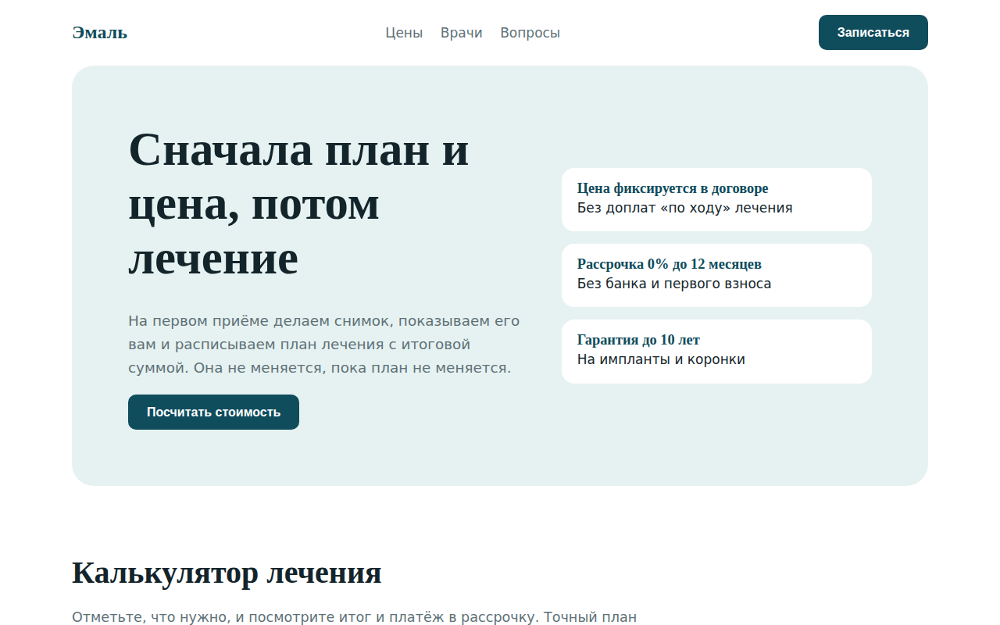

# Эмаль: стоматологическая клиника

Лендинг стоматологии с калькулятором стоимости лечения, расчётом рассрочки и формой записи к врачу. Главная идея: пациент видит цену до приёма.



## Возможности

**Калькулятор**
- Услуги сгруппированы: диагностика и гигиена, лечение, протезирование, ортодонтия
- Для поштучных услуг (пломба, имплант, коронка и т.п.) можно указать число зубов от 1 до 32
- Предварительный расчёт со списком выбранных позиций и итоговой суммой
- Рассрочка: оплата сразу, на 6 или 12 месяцев с расчётом ежемесячного платежа

**Запись и информация**
- Карточки врачей с инициалами вместо фото, стажем и специализацией
- Выбор врача в форме записи (список собирается из тех же данных)
- При выборе причины «Острая боль» форма показывает телефон для срочного приёма
- Маска телефона +7, проверка имени и номера с подсветкой полей через `aria-invalid`
- После отправки форма сообщает, что расчёт из калькулятора приложен к заявке, если услуги были выбраны
- Раздел частых вопросов на нативных `<details>`

## Стек

HTML5, CSS3 (Grid, `position: sticky`, `clamp()`), JavaScript без библиотек, шрифты Google Fonts (Literata, Commissioner).

## Как запустить

Сборка не нужна: откройте `index.html` в браузере.

Или через локальный сервер:

```bash
python -m http.server 8000
# затем откройте http://localhost:8000
```

## Настройка

Данные лежат в начале `<script>` в `index.html`:

- `GROUPS`: группы услуг, каждая услуга записана как `[id, название, цена, поштучно]`; при `true` у услуги появляется счётчик зубов
- `DOCTORS`: врачи в формате `[имя, специальность, стаж, описание]`
- Сроки рассрочки задаются кнопками с атрибутом `data-months` в разметке

## Структура проекта

```
index.html      # разметка, стили и скрипт в одном файле
screenshot.png  # скриншот для README
LICENSE         # лицензия MIT
```

## Как это устроено

- Выбранные услуги хранятся в объекте `id -> количество`, итог и строки чека пересчитываются одной функцией `render()` при каждом изменении.
- Список услуг, карточки врачей и пункты выбора врача генерируются из массивов, поэтому прайс правится в одном месте.
- Обработчики событий делегированы на `document`: один слушатель `change` для чекбоксов и один `click` для кнопок «+/−» и сроков рассрочки.
- Блок расчёта закреплён через `position: sticky` и объявлен `aria-live`, чтобы скринридер озвучивал новую сумму.
- На ширине до 860px первый экран, калькулятор и форма перестраиваются в одну колонку, у блока расчёта снимается закрепление.

## Идеи для развития

- Отправка заявки с расчётом в Telegram или на почту клиники
- Выбор свободного времени у конкретного врача
- Сохранение расчёта в localStorage или ссылкой

## Лицензия

Концепт-сайт, реального бизнеса за ним нет.

MIT © 2026 whysafe. Telegram: [@yawhysafe](https://t.me/yawhysafe) · Сайт: [whysafe.ru](https://whysafe.ru)
